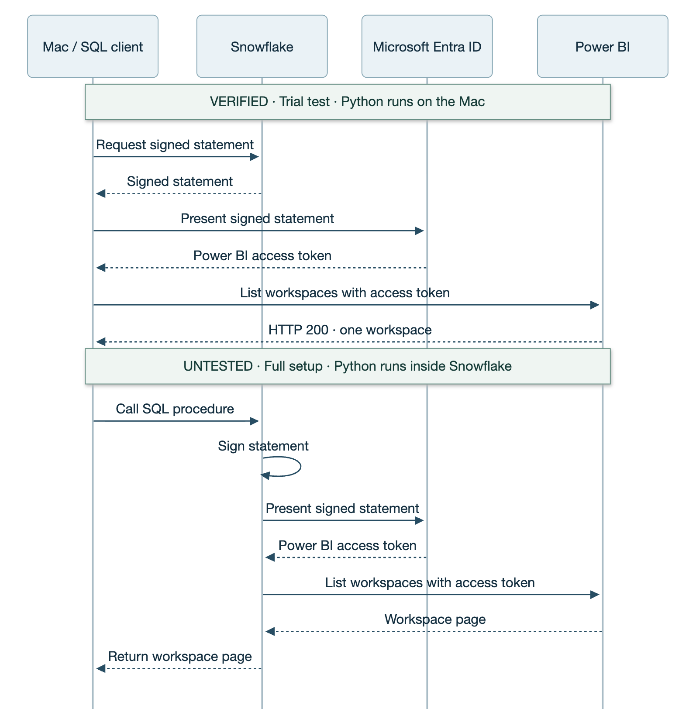

# Call the Power BI admin API from Snowflake

**The Mac test passed. The end-to-end stored procedure call is still unverified.** Snowflake issued a signed workload identity token in the trial account. Python running on the Mac exchanged it with Microsoft Entra ID and called the Power BI admin API. Both Microsoft endpoints returned HTTP 200, and Power BI returned one workspace.

## Who calls whom?

Read the diagram from top to bottom. Solid arrows show requests. Dashed arrows show replies. In the verified test, the Mac sends Snowflake’s signed statement to Entra, then sends the access token Entra returns to Power BI. In the untested setup, the client calls a SQL procedure. Python running inside Snowflake makes both requests to Microsoft.



[Open the full-size diagram](docs/images/call-paths.png)

**Why does Entra accept a request from the Mac?** Entra trusts Snowflake’s signature. The Mac signs in through its configured Snowflake CLI connection. Its active role allows it to request a short-lived, signed statement called an *assertion*. The Mac carries that statement to Entra. Entra checks the signature with Snowflake’s public key. It also checks three details against the trust settings on the registered app. The issuer identifies Snowflake, the subject identifies this workload, and the audience identifies Entra’s token exchange.

When those checks pass, Entra gives the Mac a Power BI access token for **the app**. This works without registering the Mac as a trusted device. Power BI allows the workspace request because the app’s identity in this tenant (its *service principal*) belongs to the group that Fabric allows to use read-only admin APIs.

| Where the code ran | What happened |
| --- | --- |
| Snowflake trial | Created the workload identity secret, issued the assertion, created the SQL procedure, and rejected an invalid page size as expected. |
| Mac | Ran the Python handler from the deployment SQL. The Mac made both outbound HTTPS requests and checked the returned workspace count. |
| Snowflake procedure with real outbound access | Still needs testing. The trial rejected the external access integration (the Snowflake setting that allows outbound requests) with error 509009, so the Python helper could not be deployed there. |

## Repeat the successful test from a Mac

You need Git, Python 3, and Snowflake CLI with a named connection to your trial with a default warehouse and access to the `ACCOUNTADMIN` role used by this example. You also need an Entra app and a Fabric administrator who can authorize its group for read-only admin APIs. [Install Snowflake CLI](https://docs.snowflake.com/en/developer-guide/snowflake-cli/installation)

### 1. Get the example and select your own identifiers

Use the directory (tenant) ID and application (client) ID from the Entra app registration. If you already have the repository, update your checkout and run the remaining commands from its root.

```sh
git clone https://github.com/MiguelElGallo/Snow_WIF_PBI.git
cd Snow_WIF_PBI
export SNOW_CONNECTION='your-trial-connection'
export ENTRA_TENANT_ID='your-directory-uuid'
export ENTRA_CLIENT_ID='your-application-client-uuid'
snow sql -c "$SNOW_CONNECTION" --role ACCOUNTADMIN \
  -q 'SELECT CURRENT_ACCOUNT_NAME(), CURRENT_ROLE(), CURRENT_WAREHOUSE()'
```

### 2. Configure the trust once

Add the app's enterprise application to the Entra security group allowed under Fabric's **Service principals can access read-only admin APIs**. Run `sql/01_identity.sql` against the trial. Use its issuer and subject to create an **Other issuer** federated credential on the app with audience `api://AzureADTokenExchange`. An existing setup can reuse the same secret and credential. This Mac test uses only the first SQL file. [Step-by-step setup](docs/how-to.md#create-the-group-and-authorize-the-api)

```sh
snow sql -c "$SNOW_CONNECTION" --role ACCOUNTADMIN -f sql/01_identity.sql
```

#### Which value goes where?

The last command in the file is `DESC SECRET POWERBI_WIF.API.ENTRA_IDENTITY;`. It returns one row. The first two rows of the table below name the output columns you need. Copy their **values** exactly, including case. In Microsoft Entra ID (formerly Azure AD), open **App registrations → your app → Certificates & secrets → Federated credentials → Add credential → Other issuer**.

| Take this value from | Put it here |
| --- | --- |
| Snowflake `DESC SECRET` → `workload_identity_federation_issuer` | Entra federated credential → **Issuer** |
| Snowflake `DESC SECRET` → `workload_identity_federation_subject` | Entra federated credential → **Explicit subject identifier** → **Value** (subject) |
| The audience used by the code, `api://AzureADTokenExchange` | Entra federated credential → **Audience** |
| Entra app registration → **Overview → Directory (tenant) ID** | Mac shell → `ENTRA_TENANT_ID` |
| Entra app registration → **Overview → Application (client) ID** | Mac shell → `ENTRA_CLIENT_ID` |
| Entra **Enterprise applications** → the app's service principal | Entra security group → **Members** |
| The Entra security group containing that service principal | Fabric **Service principals can access read-only admin APIs** → **Specific security groups** |

Choose a descriptive **Name** for the federated credential. The example fixes the audience in code. The issuer and subject come from your account. [Snowflake secret fields](https://docs.snowflake.com/en/user-guide/workload-identity-federation-outbound) · [Entra federated credential fields](https://learn.microsoft.com/en-us/entra/workload-id/workload-identity-federation-create-trust)

### 3. Run the HTTP handler locally

The script asks the CLI for an assertion, keeps it in process memory, and requests one workspace. It prints HTTP status and row count. Workspace names and tokens stay out of the terminal output. [Mac test script](scripts/test_from_mac.py)

```sh
python3 -m venv ~/.venvs/powerbi-wif
source ~/.venvs/powerbi-wif/bin/activate
python -m pip install requests
python scripts/test_from_mac.py
```

Here is the output from the verified Mac run.

```text
Snowflake issued the workload assertion.
Mac to Entra token endpoint: HTTP 200
Mac to Power BI admin API: HTTP 200 (workspace rows: 1)
```

An empty Power BI page gives a row count of zero. HTTP 200 confirms that Power BI accepted the request. The Mac sent the token request to Entra and the workspace request to Power BI.

## What still needs testing inside Snowflake

Use a Snowflake account that supports external access integrations. Create or confirm its workload identity secret and register **that secret's** issuer and subject in Entra. Then deploy `sql/02_external_access.sql` and `sql/03_procedure.sql` using the commands in the [deployment guide](docs/how-to.md#deploy-the-http-handler-and-procedure). Run the following SQL on a warehouse in that account.

```sql
CALL POWERBI_WIF.API.LIST_ADMIN_WORKSPACES(1, 0);
```

The end-to-end test passes when this **SQL call** returns a real Power BI page with `count` and `workspaces`. That exercises both HTTPS requests from Snowflake's Python runtime through the external access integration. The successful Mac test establishes Entra trust and Power BI authorization independently.

## Documentation

| I want to… | Start here |
| --- | --- |
| Make my first call on a configured account | [Tutorial](docs/tutorial.md) |
| Set up the trust or diagnose a failure | [How-to guide](docs/how-to.md) |
| Look up arguments, output, limits, or test coverage | [Reference](docs/reference.md) |
| Understand who can see what | [Explanation](docs/explanation.md) |
