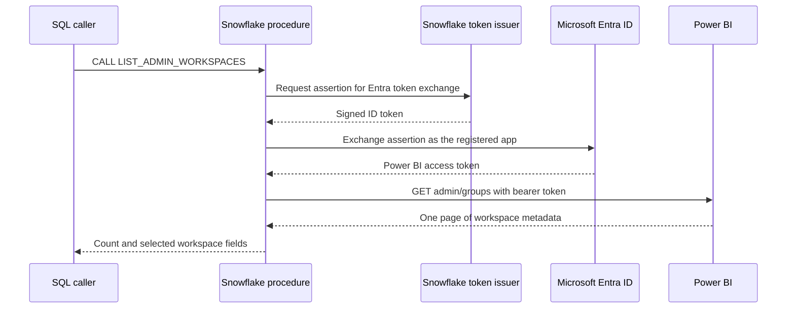

# How Snowflake calls Power BI

The SQL caller's role controls who can invoke the procedure. Entra's federated credential identifies the Snowflake workload that runs it. Calls from different authorized SQL users reach Power BI as the same Entra application.

The Snowflake secret identifies this workload. Its issuer and subject become the trust record in Entra. The assertion's audience identifies the Microsoft token exchange. The OAuth scope on the exchange identifies Power BI as the destination of the new access token. [Snowflake workload identity federation](https://docs.snowflake.com/en/user-guide/workload-identity-federation-outbound) · [Microsoft client credentials flow](https://learn.microsoft.com/en-us/entra/identity-platform/v2-oauth2-client-creds-grant-flow)

Fabric authorizes the app's service principal through its membership in the group allowed for **read-only admin APIs**. This permission covers administrative metadata across the tenant. People with permission to manage group membership or app credentials can affect who has this access. [Fabric admin API authentication](https://learn.microsoft.com/en-us/fabric/admin/enable-service-principal-admin-apis)

Inside Snowflake, an owner's-rights SQL procedure validates the page arguments and passes the assertion directly to a secure Python function within the same SQL expression. The function exchanges the assertion, calls one fixed endpoint, and projects four fields. The SQL caller receives only the workspace page. The egress integration controls which network destinations the handler can reach.
